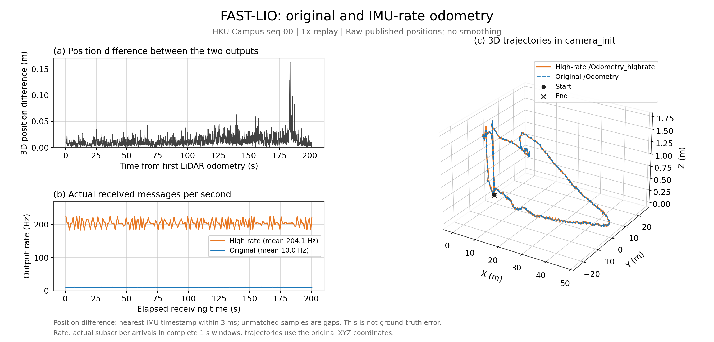
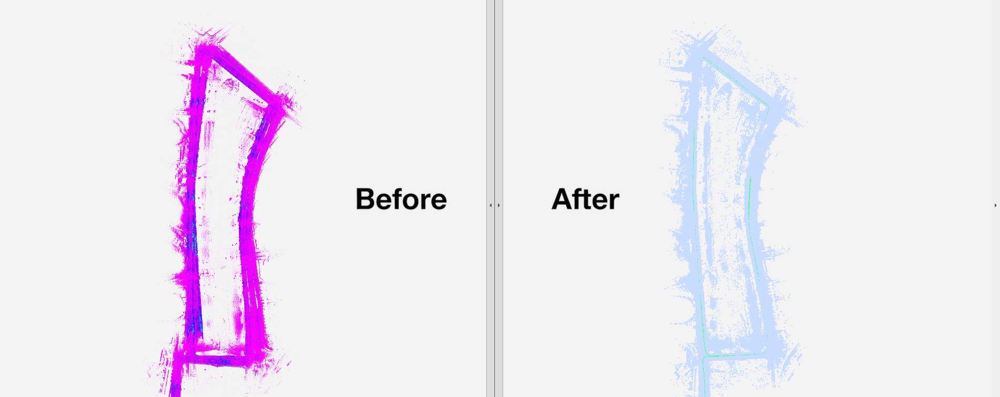
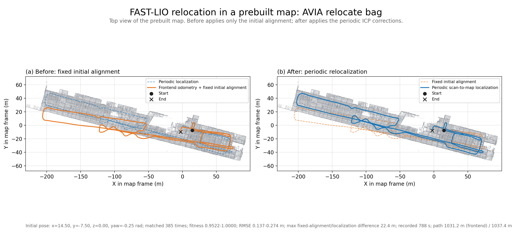

# FAST_LIO_enhanced

**面向无人机定位与三维建图的激光惯性里程计**

基于 FAST-LIO2，融合激光雷达与 IMU 数据完成运动状态估计和三维点云建图。支持 IMU 高频里程计，以及 Scan Context 回环检测、ICP 几何验证和增量位姿图优化。

主要技术栈：**C++14、ROS Noetic、Eigen、PCL、GTSAM、IKFoM、ikd-Tree**。

## 功能

- **激光惯性融合与建图**：通过迭代误差状态卡尔曼滤波完成状态估计，结合点云运动补偿、scan-to-map 匹配和 ikd-Tree 增量地图维护完成建图。
- **高频里程计（已实现）**：使用 IMU 中值积分传播运动状态，激光校正后同步状态并重传播缓存 IMU，发布 `/Odometry_highrate`。
- **回环检测与位姿图优化（已实现）**：使用 Scan Context 检索历史候选，通过虚拟相对 ICP 验证后添加 Pose3 回环边，使用 GTSAM iSAM2 更新历史轨迹与地图，并提供普通／高频里程计的全局修正输出。
- **Livox 驱动接口**：采用 `livox_ros_driver2` 消息接口；AVIA、MID360 与 HKU Campus 启动配置默认开启高频里程计，支持参数开关。
- **ROS 可视化接口**：输出里程计、配准点云、轨迹及坐标变换，支持 RViz 查看定位与建图结果。

## 高频里程计

每处理一条新 IMU，补偿偏置和重力后通过中值积分更新运动状态；激光校正后同步前端状态，插值校正时刻的 IMU 测量并重传播后续缓存。时间偏移和加速度尺度与前端一致。

`/Odometry_highrate` 的位姿以 `camera_init` 为参考坐标系，速度以 `body` 为参考坐标系，消息时间戳对应 IMU 测量时刻。原 `/Odometry` 保持激光帧更新频率。

### 效果对比

对比同一次运行中的三维位置差、实际输出频率和三维轨迹。位置差以原始里程计为参考，在其时间戳处匹配最近的高频样本（相差不超过 3 ms），计算三维位置差的模长；频率按实际接收时间统计。

<!-- highrate-comparison:start -->



<!-- highrate-comparison:end -->

## 回环检测

按累计位移和转角选取关键帧，使用 Scan Context 检索历史回环候选。将当前扫描虚拟放到历史位置附近，与按各邻帧位姿拼接的历史子图进行 ICP 配准，通过匹配误差检查后添加回环约束。使用 GTSAM iSAM2 优化历史轨迹与地图。

`loop_fusion` 按相同时间戳配对前端里程计与 body 点云，回环处理与地图重建分别在后台线程运行。根据最近关键帧的原始／优化位姿计算全局修正，同时发布 `/loop/odometry` 和 `/loop/odometry_highrate`；原 `/Odometry` 与 `/Odometry_highrate` 保持连续的局部估计。全局输出在回环修正时可能跳变。

### 效果对比

MulRan Riverside02 数据集上的轨迹与地图对比。左侧 **Before** 为前端原始结果，右侧 **After** 为回环优化结果；重访区域的地图重影减轻，轨迹闭合更一致。



## 预建地图重定位

独立的 `fastlio_localization` 模块使用预建 PCD 地图与同时间戳的 body 扫描、局部里程计，通过粗、精两级 ICP 更新地图系修正。支持 RViz `/initialpose` 粗初值和重新初始化，发布 `/localization/odometry`、`/localization/odometry_highrate` 及匹配状态。定位与 `loop_fusion` 并列接收前端数据，不叠加回环修正、不回写前端。运行说明保存在本地 `docs/localization/README.md`。

### 效果对比

AVIA 预建地图重定位数据上的轨迹与地图对比。橙色为仅使用给定粗初值的固定对齐轨迹，蓝色为周期 scan-to-map 重定位轨迹；实线为当前面板的主轨迹，虚线为对照，两图使用同一预建地图。



回放 788 s、约 1 km 轨迹，385 次匹配被接受，fitness 为 0.952～1.0，内点 RMSE 为 0.137～0.274 m；粗初值相对首次 ICP 修正的偏航误差约 4.4°，固定对齐与周期重定位轨迹最大相差约 22 m。配准指标与轨迹偏差用于说明重定位效果，不是绝对定位精度。

## 工程结构

```text
FAST_LIO_enhanced/
├── FAST_LIO/
│   ├── config/                 # 传感器、外参与估计参数，含 Riverside02
│   ├── include/                # 状态定义、滤波与地图数据结构
│   ├── launch/                 # 前端启动、数据集与 ROS bag 播放
│   ├── scripts/                # Riverside02 点云与 IMU 数据读取
│   ├── src/
│   │   ├── imu_odometry.hpp    # 高频 IMU 传播与状态同步
│   │   ├── IMU_Processing.hpp  # IMU 初始化与点云运动补偿
│   │   └── laserMapping.cpp    # 激光惯性估计、建图与输出
│   ├── CMakeLists.txt
│   └── package.xml
├── loop_fusion/
│   ├── config/                # 回环参数
│   ├── include/scancontext/  # 描述子与 KD-tree
│   ├── launch/               # 独立回环后端启动
│   ├── rviz_cfg/             # 原始/优化轨迹与地图对比
│   └── src/                  # 输入配对、回环验证、iSAM2 与结果导出
├── fastlio_localization/
│   ├── include/              # 参数、匹配与定位类定义
│   ├── launch/               # 独立定位启动
│   └── src/                  # 点云解码、两级 ICP、双频输出与节点入口
└── README.md
```

前端 ROS 包名为 `fast_lio`，主节点为 `fastlio_mapping`；回环包名为 `loop_fusion`，后端节点为 `fastlio_loop`；定位包名为 `fastlio_localization`，节点为 `fastlio_localization_node`。

